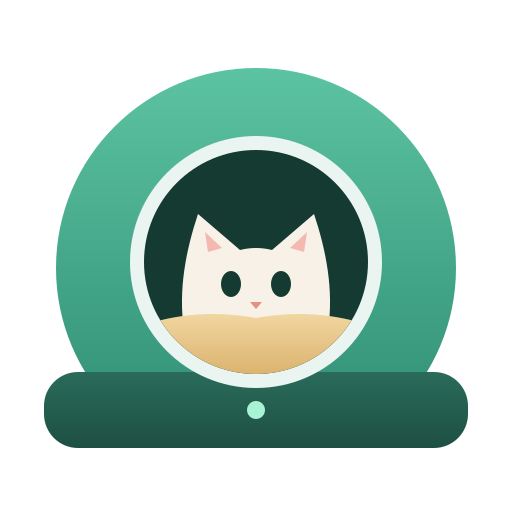

<p align="center">
  
</p>

# UAHPET for Home Assistant

[](https://hacs.xyz/docs/faq/custom_repositories)
[](https://github.com/cruzpazv/uahpet-homeassistant/releases)
[](https://github.com/cruzpazv/uahpet-homeassistant/actions/workflows/hassfest.yml)
[](https://github.com/cruzpazv/uahpet-homeassistant/actions/workflows/hacs.yml)
[](https://github.com/cruzpazv/uahpet-homeassistant/actions/workflows/tests.yml)
[](LICENSE)
[](custom_components/uahpet/manifest.json)
[](https://www.home-assistant.io/)

Home Assistant support for **UAHPET** pet devices. UAHPET devices run on Tuya, but the official Tuya integration only shows their standard data points. This package talks to them **locally** and exposes everything the UAHPET app can do, plus dashboard cards.

## Supported devices

| Device | Tuya category / product | How | What you get |
|---|---|---|---|
| Self-cleaning litter box | `msp` / `y0kvbmrnprybewtd` | **This integration** (local) | Every DP: clean, level, empty, sleep mode, child lock, ionizer, radar, waste bin, alerts, cat weight per visit… The Tuya integration only shows 5 of 27 |
| Air Purifier Slim | `kj` / `dhhzjzdaiyshx2md` | Official Tuya integration + the card from this package | All 8 DPs are already in the Tuya integration |
| Air Purifier (large, with hair suction) | `kj`? | Not yet | Needs a DP dump, see [Adding a device](#adding-a-device) |
| Fresh Food Feeder | ? (app code `wsq`) | Not yet | Needs a DP dump |

Other UAHPET products (fountains, Nano Deodorizer, iRetriever, Pulse tracker) are not connected to the UAHPET app over Wi-Fi.

## Install

**HACS (custom repository)**
HACS → ⋮ → Custom repositories → `https://github.com/cruzpazv/uahpet-homeassistant` → type *Integration* → Download → restart Home Assistant.

**Manual**
Copy `custom_components/uahpet` into `config/custom_components/` and restart.

## Get the device ID and local key

Local Tuya control needs the device's **local key**. Either:

- `tools/tuya_schema.py` in this repo (Tuya IoT Platform credentials). `--region eu` lists your devices, `--device <id>` writes `tuya_dump_<id>/info.json` with `local_key`.
- or `python -m tinytuya wizard`.

The local key changes every time a device is paired again. Use **Reconfigure** on the integration when that happens.

## Setup

Settings → Devices & services → Add integration → **UAHPET**: device ID and local key. The name, IP address and protocol version are optional: the device type and protocol are detected automatically, and an empty IP means "find it on the network". Reserve the device's IP in your router.

**Using the official Tuya integration as well?** Both can run at the same time. To avoid duplicated entities, disable the litter box in the Tuya integration (Devices → litter box → ⋮ → Disable). Keep the air purifiers in the Tuya integration.

## Litter box entities

| Entity | DP | Notes |
|---|---:|---|
| Sensor *Last cat weight* | 106 | Weight of the last visit (kg). Best weight source for [Litter Cat Identifier](https://github.com/cruzpazv/litter-cat-identifier) |
| Sensor *Live weight* | 6 | Real-time scale, 0 when empty |
| Sensor *Visits today* | 7 | Resets at midnight |
| Sensor *Last visit duration* | 8 | Seconds |
| Sensor *Status* | 108 | Standby, cleaning, emptying, levelling, weighing error, cat detected, waiting for litter to clump |
| Sensor *Waste bin* | 113 | OK, full, missing, cover open |
| Sensor *Active alerts* | 21, 22 | Number of active alerts, attribute `alerts` |
| Binary sensors (8) | 21, 22 | Too many visits, no weight, stagnant, not in place, weighing error, bin cover open, bin full, motor fault |
| Button *Clean* / *Level litter* / *Empty litter* | 3 / 103 / 107 | |
| Switch *Auto clean* | 4 | |
| Switch *Sleep mode* | 101 | |
| Switch *Child lock* | 102 | |
| Switch *Ionizer* | 114 | |
| Switch *Radar* | 115 | Presence radar |
| Number *Clean delay* | 5 | 10–1800 s after a visit |
| Number *Bury delay* | 117 | 5–60 s |
| Number *Too many visits threshold* | 118 | 0–50 |
| Select *Litter type* | 2 | Coarse / fine grain |
| Select *Device weight unit* | 111 | kg / lb on the device itself |
| *Disabled by default:* motor forward / reverse | 104 / 105 | Manual motor control, **no safety sequence**: never enable with a cat nearby |
| *Disabled by default:* developer mode, cycle phase, work log code | 112, 116, 119 | Diagnostics |

Not exposed: DP 20 (cloud schedules, raw) and DP 109/110 (pound copies of the weights; Home Assistant converts units itself).

Still unknown: the meaning of the *stagnant* alert and the packed format of DP 119 (`log_code` shows its bytes as attributes). Reports welcome.

## Dashboard cards

The cards load automatically with the integration. Add them from the card picker (search "UAHPET") or in YAML. `device_id` is optional: without it each card uses the first matching device.

```yaml
type: custom:uahpet-litterbox-card       # status, alerts, actions, toggles
show_alerts: true
show_actions: true                        # Empty needs a second tap to confirm
show_toggles: true
```

```yaml
type: custom:uahpet-litterbox-settings-card
show_advanced: false                      # true adds the hidden diagnostic and motor entities
```

```yaml
type: custom:uahpet-litterbox-history-card
days: 30                                  # cat weight per visit and visits per day
```

```yaml
type: custom:uahpet-purifier-card         # entities from the Tuya integration (XTend Tuya works too)
device_id: <the purifier's device>
show_modes: true                          # manual / auto / sleep
show_speed: true                          # sleep, 1, 2, 3
show_timer: true                          # off, 2–10 h
show_extras: true                         # child lock and filter reset (needs a second tap)
```

The purifier card shows power, air quality, remaining filter life (amber below 30 %, red below 15 %), mode, speed and timer. When the purifier tilts over 45° it reports the mode `tipping`: the card shows a "tipped over" alert instead of offering it as a mode. With several purifiers, add one card per purifier.

The cards are served by this integration, so at least one UAHPET device must be set up for them to load.

Full example: [examples/dashboard.yaml](examples/dashboard.yaml).

## Telling cats apart

This integration only talks to the device. To name each visit after the right cat, add [Litter Cat Identifier](https://github.com/cruzpazv/litter-cat-identifier) with *Last cat weight* as the weight sensor and *Visits today* as the visit counter.

## Adding a device

1. Dump its data points with `tools/tuya_schema.py --region <region> --device <device id>` (needs a free Tuya IoT Platform project linked to the Smart Life app). Share `schema.md`, **never** `info.json` (it holds the local key).
2. Compare with what the official Tuya integration already shows. If it covers everything, a card is enough (like the air purifier).
3. Otherwise add a profile: a module in `custom_components/uahpet/profiles/` with a `Profile` (DP ids, detection `signature`, entity descriptions), append it to `PROFILES`, and add the entity names to `strings.json` and `translations/`.

## Development

```bash
pip install pytest-homeassistant-custom-component==0.13.316 tinytuya==1.20.0
pytest -q
```

Icon source: [assets/icon.svg](assets/icon.svg) (`rsvg-convert -w 256 -h 256 assets/icon.svg -o custom_components/uahpet/brand/icon.png`, and `-w 512 -h 512` for `icon@2x.png`).
